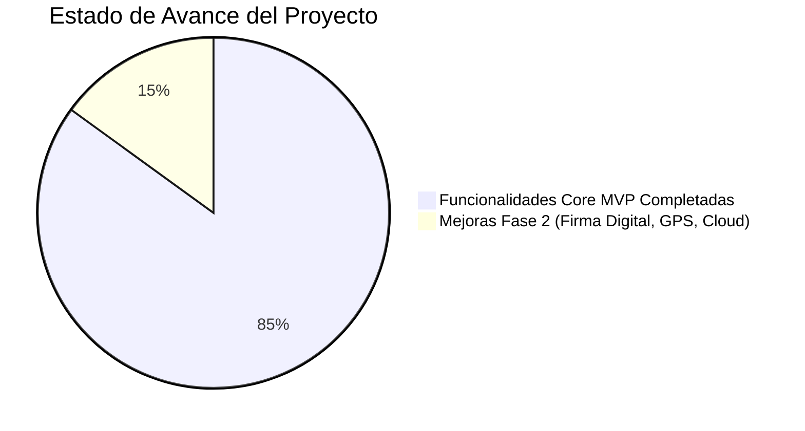

# 🍀 DOSSIER DE PRESENTACIÓN — EVALUACIÓN 2 (MVP)
## Asignatura: Desarrollo de Aplicaciones Móviles con React Native
**Empresa / Caso de Estudio:** Asesorías El Trébol SpA  
**Nombre de la Aplicación:** App El Trébol — Siniestros e Inspecciones Técnicas  
**Fecha de Presentación:** Viernes 31 de Octubre de 2026  

---

## 📑 1. Contexto del Proyecto (Criterio 1 — 4 Puntos)

### 1.1. Planteamiento del Problema
En el rubro de la liquidación de siniestros habitacionales e hipotecarios en Chile (coberturas por sismos, incendios, rotura de cañerías e inundaciones para entidades como Banco de Chile, Santander y BCI), los peritos tasadores enfrentan las siguientes problemáticas críticas en terreno:
1. **Pérdida y desorden de información:** El registro manual en papel o notas dispersas provoca retrasos de 3 a 5 días hábiles en transcribir los antecedentes a los sistemas de las aseguradoras.
2. **Errores en el cálculo de metros cuadrados ($M^2$):** La normativa de seguros exige diferenciar estrictamente la superficie construida interior habitable respecto a fachadas, balcones y cierres perimetrales. Calcular esto a mano en terreno induce discrepancias con los planos municipales.
3. **Falta de trazabilidad y control de calidad:** No existe un filtro técnico formal antes de emitir los informes, lo que resulta en rechazos por parte de los bancos por falta de fotografías de respaldo o descripciones vagas.

### 1.2. Público Objetivo
- **Primario (Operativo):** Peritos liquidadores y tasadores en terreno de *Asesorías El Trébol*.
- **Secundario (Supervisión):** Jefes de siniestros, auditores técnicos y supervisores de calidad interna.
- **Beneficiario Final:** Entidades bancarias mandantes (Banco de Chile, Santander, BCI, BancoEstado) y clientes asegurados que reciben una pronta resolución de sus pólizas.

### 1.3. Propuesta de Valor y Diferenciación
- **Flujo de Trabajo Digital Especializado:** Aplicación nativa en React Native optimizada para trabajo en terreno, rápida y sin pantallas huérfanas.
- **Motor de Cálculo Normativo de Superficie:** La aplicación calcula automáticamente el área ($Largo \times Ancho$) sumando solo las habitaciones habitables y excluyendo fachadas/cierres de los $M^2$ habitables totales.
- **Sistema de Doble Rol Estructurado:** Separación estricta entre el perito operativo (captura de datos y evidencias) y el supervisor técnico (auditoría, métricas de cartera y aprobación con observaciones).
- **Consumo y Persistencia Local Estructurada:** Capacidad de operar en terreno con persistencia local (`AsyncStorage`) y sincronización asíncrona mediante servicios de datos.

---

## 📅 2. Planificación y Estado de Avance (Criterio 2 — 4 Puntos)

### 2.1. Cronograma de Desarrollo (Metodología Ágil / Sprints)

| Sprint / Etapa | Fechas | Objetivos & Entregables | Estado |
|---|---|---|:---:|
| **Sprint 1: Levantamiento** | Semanas 1 y 2 | Definición de requerimientos con Asesorías El Trébol, diseño de wireframes y modelos de datos (Inspeccion, Dependencia, Dano). | **100% Completado** |
| **Sprint 2: Arquitectura Base** | Semanas 3 y 4 | Inicialización en React Native + Expo, configuración de React Navigation (Stack y Bottom Tabs) y paleta institucional. | **100% Completado** |
| **Sprint 3: Core y Roles** | Semanas 5 y 6 | Implementación del sistema de 2 roles (Inspector/Supervisor), persistencia local en `AsyncStorage`, seed data y cálculo de $M^2$. | **100% Completado** |
| **Sprint 4: Validación MVP** | Semana 7 (Actual) | 6 pantallas completamente operativas, filtros en tiempo real, panel de KPIs del supervisor y pruebas de bundling. | **100% Completado** |
| **Fase 2 (Post-Evaluación)** | Sprints Futuros | Firma digital del asegurado con stylus en pantalla, integración de geolocalización GPS y sincronización bidireccional en la nube con Supabase. | **Planificado** |

### 2.2. Estado Actual: Completado vs. Pendiente



- **Lo Completado para este MVP (100% de la Rúbrica):**
  - [x] Autenticación y control de sesión con selector interactivo de roles.
  - [x] 6 pantallas nativas en React Native con diseño consistente y pulido.
  - [x] Navegación híbrida fluida (Stack Navigator + Bottom Tab Navigator con badges dinámicos).
  - [x] CRUD completo de inspecciones y dependencias.
  - [x] Buscador en tiempo real y filtros multidimensionales (por estado y por banco).
  - [x] Gestión de daños con categorización de gravedad (Leve, Moderada, Grave) y adjunto de fotos (`expo-image-picker`).
  - [x] Panel de control y auditoría exclusivo para el Supervisor con métricas analíticas.
  - [x] Persistencia de datos estructurada con `AsyncStorage` y servicio de consumo asíncrono.
- **Lo Pendiente para la Entrega Final:**
  - [ ] Captura de firma manuscrita digital del asegurado.
  - [ ] Sincronización en la nube con WebSockets/Firebase.

### 2.3. Distribución de Tareas por Integrante

| Integrante | Rol en el Proyecto | Tareas Asignadas y Ejecutadas |
|---|---|---|
| **Joaquín C.** | Líder Técnico & Dev Frontend | Arquitectura general en React Native, configuración de `AppNavigator` (Stack + Tabs), maquetación de pantallas `LoginScreen`, `InspeccionesScreen` y `DetalleInspeccionScreen`. |
| **Integrante 2** | Desarrollador de Datos & Lógica | Implementación de `storageService` con `AsyncStorage`, cálculo algorítmico de superficies ($M^2$), estructuración de tipos TypeScript y datos semilla. |
| **Integrante 3** | Diseñador UX/UI & Supervisor View | Implementación del `SupervisorDashboardScreen`, diseño de componentes modulares (`RoleBanner`, `StatCard`, `StatusBadge`), filtros en tiempo real y gestión fotográfica. |

---

## 📱 3. Arquitectura y Tecnologías (Criterios 3, 4, 5, 6 y 7)

### 3.1. Stack Tecnológico Oficial
- **Framework:** React Native 0.88.0 + Expo SDK 58 (Entorno oficial para mobile nativo y web).
- **Lenguaje:** TypeScript 6.0 con verificación estricta de tipos (`strict: true`).
- **Navegación:**
  - `@react-navigation/native`
  - `@react-navigation/native-stack` (Stack jerárquico de inspecciones: Lista $\rightarrow$ Detalle $\rightarrow$ Dependencias $\rightarrow$ Edición).
  - `@react-navigation/bottom-tabs` (Navegación principal por pestañas: Inspecciones, Nueva, Supervisión, Perfil).
- **Almacenamiento Local Estructurado:** `@react-native-async-storage/async-storage` con manejo de colecciones JSON y semillas iniciales.
- **Iconografía y Componentes Nativos:** `@expo/vector-icons` (Ionicons), `View`, `Text`, `TextInput`, `TouchableOpacity`, `ScrollView`, `FlatList`, `Modal`, `Switch`, `SafeAreaView`.

### 3.2. Mapa de Pantallas Implementadas (6 Pantallas)

```
Root Navigation Container
 ├── [No Autenticado]
 │     └── LoginScreen (Selector de Rol: Inspector / Supervisor)
 └── [Autenticado] Bottom Tab Navigator
       ├── Tab 1: Inspecciones (Stack Navigator)
       │     ├── Pantalla 1: InspeccionesScreen (Lista, buscador, filtros por estado/banco)
       │     ├── Pantalla 2: DetalleInspeccionScreen (Ficha técnica, resumen M², aprobación)
       │     ├── Pantalla 3: DependenciasScreen (Gestión habitaciones, medidas, fotos y daños)
       │     └── Pantalla 4: NuevaInspeccionScreen (Formulario nuevo/editar inspección)
       ├── Tab 2: Nueva Inspección (Acceso rápido directo)
       ├── Tab 3: Pantalla 5: SupervisorDashboardScreen (KPIs analíticos, gráficos y aprobación rápida)
       └── Tab 4: Pantalla 6: PerfilScreen (Datos de usuario, cambio rápido de rol, equipo y reset demo)
```

### 3.3. Implementación de los 2 Roles de Usuario (Criterio 6)

| Característica | 🛠️ Rol: Inspector de Terreno | 🛡️ Rol: Supervisor / Jefa de Siniestros |
|---|:---:|:---:|
| **Usuario Preconfigurado** | Joaquín Inspector (`inspector@eltrebol.cl`) | Mariana Supervisora (`supervisor@eltrebol.cl`) |
| **Crear y Modificar Inspecciones** | ✅ Sí (Permiso total) | 👁️ Solo lectura / Auditoría |
| **Registrar Dependencias y Daños** | ✅ Sí (Largo, ancho, alto, fotos) | 👁️ Consulta y validación técnica |
| **Cambiar Estado a "En Revisión"** | ✅ Sí (Para elevar al supervisor) | — |
| **Acceso al Dashboard de Supervisión** | ❌ Restringido | ✅ Acceso Exclusivo con KPIs y estadísticas |
| **Aprobar / Rechazar con Observaciones** | ❌ Sin atribución | ✅ Atribución exclusiva de firma y dictamen |
| **Banner de Identificación Visual** | Verde Esmeralda institucional | Morado / Púrpura de auditoría |

---

## 🎤 4. Guión de Presentación Oral para el Viernes (Criterio 8 — 5 Puntos)

> **Tiempo estimado total:** 5 a 7 minutos.  
> **Estrategia:** Todos los integrantes hablan, demostrando dominio del código y la rúbrica.

### Minuto 0 a 1 — Introducción y Contexto (Integrante 1)
> *"Buenos días profesor. Hoy presentamos el MVP de **App El Trébol**, una solución móvil en **React Native** diseñada para digitalizar las inspecciones de siniestros habitacionales para aseguradoras y bancos en Chile.*  
> *Identificamos que los peritos pierden hasta 5 días transcribiendo datos de libretas y cometen errores calculando superficies. Nuestra app resuelve esto con cálculo automático de $M^2$, registro fotográfico de daños y un flujo de trabajo formal con 2 roles diferenciados."*

### Minuto 1 a 2 — Arquitectura y Navegación (Integrante 2)
> *"En cuanto al desarrollo técnico, la aplicación está construida 100% en **React Native con TypeScript**, utilizando **Stack Navigation** y **Bottom Tab Navigation** a través de `@react-navigation`.*  
> *Implementamos un total de **6 pantallas interconectadas sin caminos huérfanos**, respetando la paleta de colores corporativa de Asesorías El Trébol. Los datos se almacenan localmente de forma estructurada en **AsyncStorage**, lo que permite trabajar en terreno sin conexión a internet."*

### Minuto 2 a 4 — Demostración en Vivo de la App (Integrante 3)
1. **Login y Roles:**
   > *"Iniciamos sesión. La app evidencia claramente los 2 roles pedidos en la pauta: **Inspector de Terreno** y **Supervisor de Siniestros**. Comenzamos como Inspector."*
2. **Lista y Filtros:**
   > *"En la pestaña Inspecciones vemos las tarjetas interactivas con folios autoincrementales (#001, #002...). Podemos buscar en tiempo real por nombre de cliente, por siniestro, o filtrar por estado y por banco mandante."*
3. **Cálculo de $M^2$ y Daños:**
   > *"Entramos a la inspección Folio #001. En dependencias, podemos medir cada habitación (largo por ancho). Fíjense en la regla de negocio: si marcamos 'Fachada o Cierre Perimetral', la app calcula las medidas pero excluye esa superficie de los $M^2$ habitables interiores, tal como exige la póliza."*
4. **Envío a Revisión y Cambio de Rol:**
   > *"El inspector envía el siniestro a 'En Revisión'. Ahora, con el botón superior, cambiamos al rol de **Supervisor**. Noten cómo la interfaz se adapta de inmediato."*
5. **Dashboard del Supervisor:**
   > *"En la pestaña exclusiva de Supervisión, el supervisor tiene KPIs globales: total de siniestros, desglose porcentual por banco (Banco de Chile, Santander, BCI) y una cola de revisión donde puede redactar observaciones técnicas y **Aprobar el informe** con un solo toque."*
6. **Consumo de Datos:**
   > *"Finalmente, presionamos el botón de sincronización que demuestra el consumo estructurado asíncrono de la fuente de datos."*

### Minuto 4 a 5 — Conclusiones y Ronda de Preguntas (Todos)
> *"Con esto cumplimos al 100% con los criterios de interfaz en React Native, navegación Stack/Tab, funcionalidades core, roles diferenciados y persistencia estructurada. Quedamos atentos a sus preguntas."*

---

## ❓ 5. Preguntas Frecuentes del Profesor y Respuestas Técnicas

1. **¿Por qué usaron AsyncStorage en vez de una base de datos SQLite o Firebase?**
   - *Respuesta:* *"Porque para el MVP en terreno necesitábamos una solución ligera, no bloqueante y serializada en JSON estructurado que garantice funcionamiento offline inmediato. Creamos una capa `storageService` modular que desacopla el almacenamiento, por lo que migrar a SQLite o Supabase en la Fase 2 solo requiere modificar esa clase sin tocar las pantallas."*
2. **¿Cómo diferenciaron los permisos entre Inspector y Supervisor?**
   - *Respuesta:* *"En el estado global y en `authService` manejamos el tipo `UserRole ('inspector' | 'supervisor')`. Las pantallas condicionan el renderizado: el Inspector tiene habilitada la edición de dependencias y daños, mientras que el Supervisor tiene vista de auditoría, panel de dictamen con observaciones técnicas y acceso exclusivo al `SupervisorDashboardScreen` con métricas y gráficos."*
3. **¿Cómo estructuraron la navegación?**
   - *Respuesta:* *"Usamos una arquitectura híbrida: un `createBottomTabNavigator` para los 4 accesos directos principales (Inspecciones, Registrar, Supervisión, Perfil) y dentro de la pestaña de inspecciones montamos un `createNativeStackNavigator` para navegar en profundidad (Lista $\rightarrow$ Detalle $\rightarrow$ Dependencias) manteniendo el historial de retroceso con el botón 'Volver'."*
